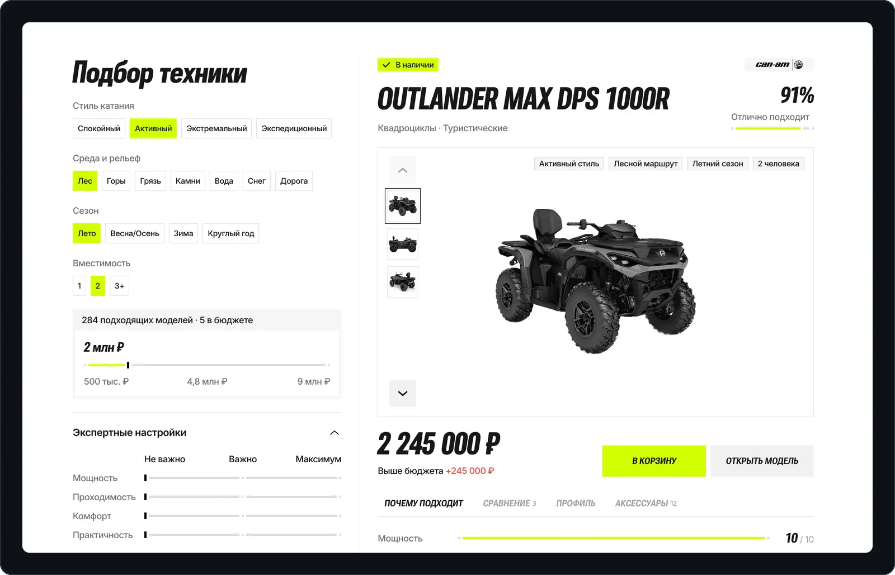

# smart-calculator

Прототип адаптивной страницы, которая помогает покупателю подобрать технику под поездку: слева параметры, справа рекомендованная модель, воронка отбора, финалисты и баннер среды.

<a href="https://smart-calculator-jet.vercel.app"></a>

**→ [Открыть демо](https://smart-calculator-jet.vercel.app)**

## Что умеет

- **Подбор по параметрам поездки.** Стиль катания, среда, сезон, вместимость, бюджет и экспертные настройки с ползунками приоритетов.
- **Рекомендованная модель.** Фото-галерея, цена, вкладки, метрики, профиль и наличие.
- **Сравнение.** Альтернативы чипами и вывод «Почему основная модель выше».
- **Путь к выбору.** «Как мы пришли к этому выбору» и «Финальный выбор» с кольцами финалистов.
- **Баннер среды и итог подбора.** Баннер «ДОРОГА · ЛЕС · ГОРЫ» и модалка «Ваш подбор».
- **Корзина.** «В корзину» → счётчик в шапке → выезжающая корзина; оформление заказа заблокировано.
- **Адаптив.** От 1920 до 393: на < 1200 одна колонка, параметры в шторке «Фильтры».

## Запуск

Нужен Python 3.

```bash
python3 serve.py
```

Открой `http://localhost:5173` (если порт занят — возьмёт следующий свободный). Сервер отдаёт файлы проекта и проксирует фото, шрифты и API на исходный сайт. Сборки и тестов нет. Публикация — `./deploy.sh`, подробнее в [docs/deploy.md](docs/deploy.md).

## Стек

HTML · CSS · JavaScript

## Устройство

```
index.html     шапка, подвал и разметка калькулятора
data/          каталог моделей
js/tlsc.js     логика подбора — не меняется
js/enhance.js  поведение интерфейса
css/           токены и стили по блокам
vendor/        шапка, подвал и корзина сайта
serve.py       локальный сервер с прокси
deploy.sh      публикация на Vercel
```

Брейкпоинты и таблица файлов — в [docs/architecture.md](docs/architecture.md).

## Документация

- [Паспорт проекта](CLAUDE.md)
- [Журнал аудитов](docs/AUDIT_LOG.md)
- [Устройство и брейкпоинты](docs/architecture.md)
- [Публикация](docs/deploy.md)
- [Ограничения прототипа](docs/prototype-limits.md)

## Лицензия

[MIT](LICENSE). Каталог, изображения и внешние ссылки загружаются с исходного сайта; оформление заказа отключено.
